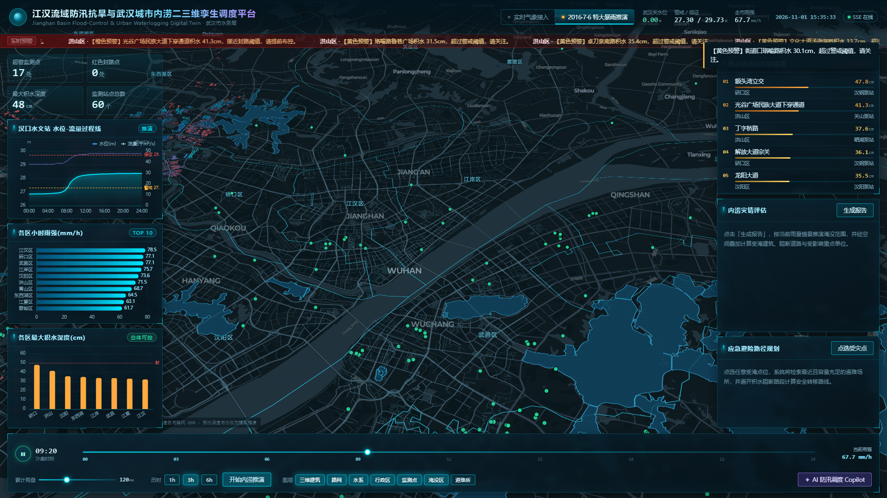
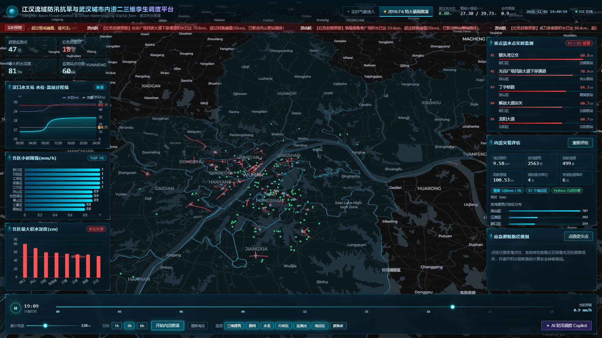
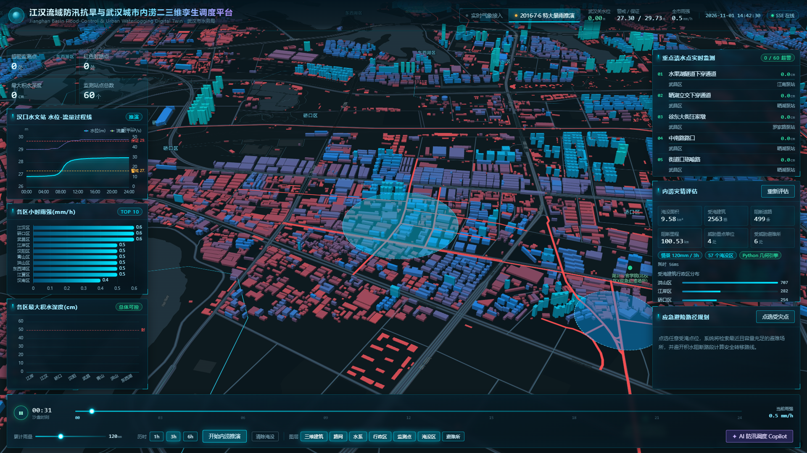
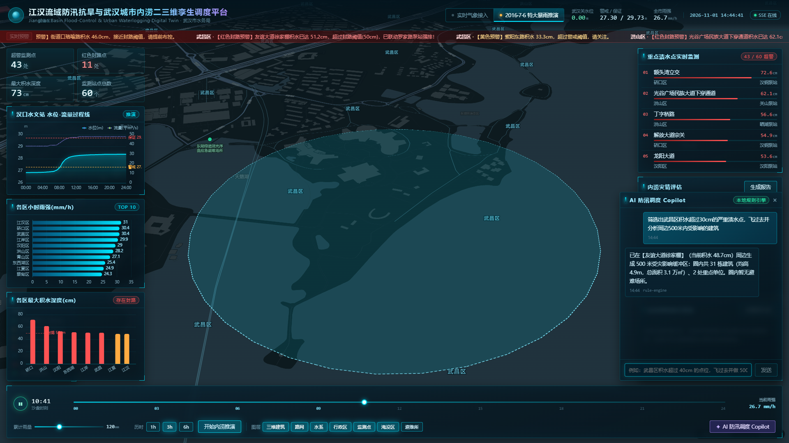
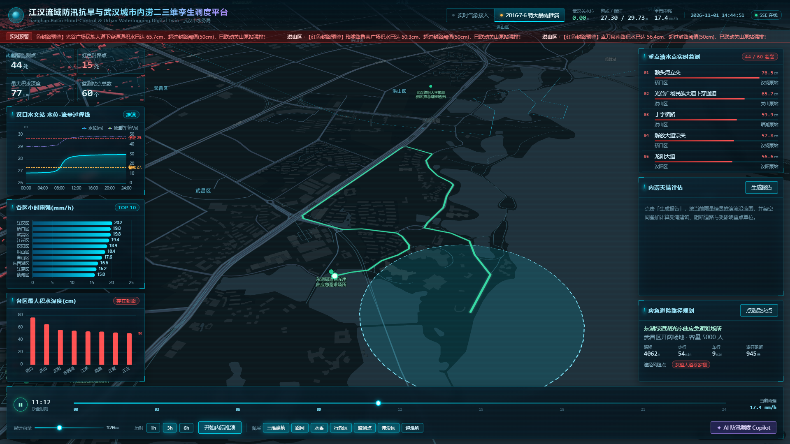
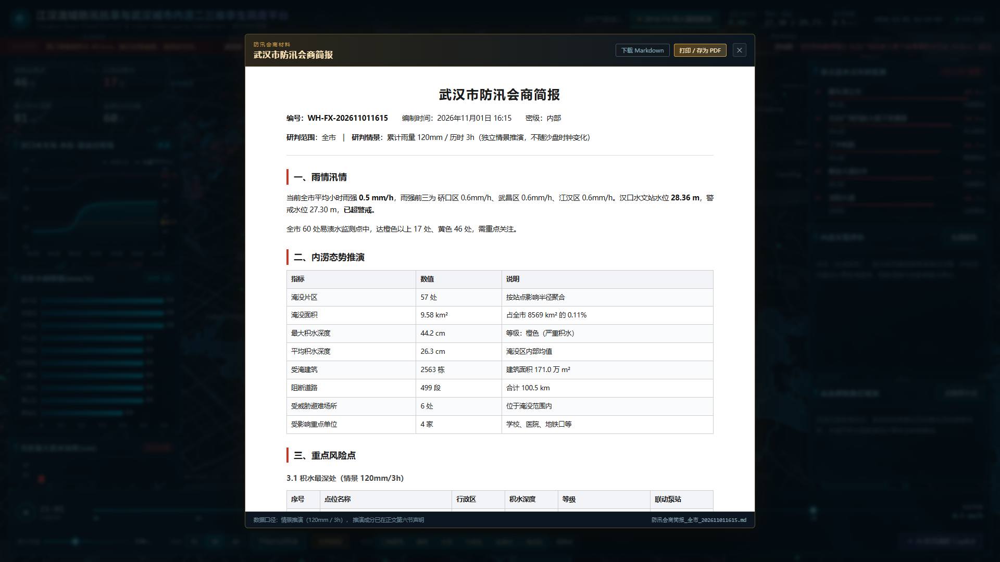

# 江汉流域防汛抗旱与武汉城市内涝二三维孪生调度平台

<div align="center">

      

**🎬 [观看 3 分钟演示视频（1080p，含字幕）](docs/demo/wuhan-flood-twin-demo-1080p.mp4)**

[](docs/demo/wuhan-flood-twin-demo-1080p.mp4)

</div>

> 在《智慧文旅·武汉》原型（`end5`）基础上全面重构的防汛应急方向 WebGIS 工程。
> 双空间引擎（PostGIS / 纯 Python，可切换）+ 空间分片按需加载 + 实时水雨情 + 内涝推演 + 避险路径 + AI 调度 Copilot。
> 默认 `local` 模式无需 Docker 即可完整运行；生产模式提供 PostGIS + Martin MVT 编排。



---

## 1. 相比原项目的三大重构

| 原项目痛点 | 本系统方案 |
| --- | --- |
| `json-server` 全量拉取 100MB 建筑 + 12MB 道路，首屏白屏 8s+ | 数据预处理为 **z12 空间分片**，按视域 bbox 按需加载；生产模式由 **Martin 发布 PostGIS MVT 瓦片**，20.6 万建筑秒级渲染 |
| 全部为本地死数据 | **Open-Meteo 免 Key 实时气象 API**（13 区逐时雨强）+ 汉口水文站水位；**SSE** 3 秒级推送超警/封路预警 |
| 缺乏空间分析与业务闭环 | **内涝淹没推演 → 承灾体空间叠加评估 → 避障转移路径规划 → AI 自然语言控图** 完整闭环 |

## 2. 功能总览（对应 PRD 四大模块）

1. **高性能数字孪生底座**：MapLibre GL 暗色球面底图 + `fill-extrusion` 三维白模（按楼高 `Elevation` 拉伸、按高程风险着色），水系/行政区划/路网/避难所多图层中心，视域级按需加载。
2. **实时水雨情监测与 SSE 预警**：60 个易渍水点 + 4 个水文站 + 12 座排涝泵站，按积水深度四级配色（绿/黄/橙/红），红色点位雷达脉冲；顶部滚动预警条由 SSE 实时驱动；左侧 ECharts 面板绘制《汉口站水位-流量过程线》《各区小时雨强排行》《各区最大积水深度》。
3. **内涝动态推演与灾情评估**：雨量滑块（50~250mm）× 历时（1/3/6h），按区级水量平衡模型积分出各渍水点积水深度，自动生成淹没区（半径 = 深度 × 8.5m 扩散系数），叠加统计**受淹建筑栋数/面积、阻断道路条数/里程、受威胁重点单位与避难所**，阻断路段在地图上变红禁行。
4. **避险路径 + AI 调度 Copilot**：点选任意位置，后端在路网子图上跑 **A\* 最短路（优先严格避开积水路段，不可达时按 ×8 代价降级涉水通行）**，绿色高亮路线 + 沿线流动光标；AI 助手支持"筛选出武昌区积水超过 40cm 的渍水点，飞过去并做 500 米缓冲分析"类自然语言指令，解析为 `FLY_TO / DRAW_BUFFER / SHOW_ROUTE` 等地图动作。
5. **防汛会商简报一键生成**：按当前情景（雨量/历时）自动编制带编号的《防汛会商简报》——雨情汛情、内涝态势、重点风险点（渍水点/避难所/重点单位）、分区影响排序、**规则化处置建议**（交通管控/力量预置/堤防巡查，逐条对应推演数值）与数据免责声明；预览窗内一键下载 Markdown（OA/工作群直发）或打印为 PDF。所有数字实时来自推演结果，附"实测/模型"数据来源声明。







## 3. 技术栈

| 层 | 选型 |
| --- | --- |
| 前端 | Vue 3.5 + TypeScript + Vite 5 + Pinia + MapLibre GL 4 + ECharts 5 + Axios |
| 后端 | **双运行时**：FastAPI（生产） / Python 标准库 HTTP 服务（零依赖开发模式），共用同一业务处理层 |
| 空间引擎 | **双引擎**：纯 Python 几何引擎（点面判断/圆缓冲/线面裁剪/网格索引/A\*，零第三方依赖） / PostGIS（`ST_Buffer` + `ST_Intersects`，SQL 见 `backend/sql/init.sql`） |
| 瓦片 | 预生成 z12 GeoJSON 分片（113 个建筑片 + 50 个道路片） / Martin MVT（生产） |
| 数据 | 20.6 万建筑、2.9 万道路、195 避难所、376 重点单位、76 监测站点、13 区边界 |
| 部署 | Docker Compose：PostGIS 15 + Martin v0.13 + Redis 7 + FastAPI + Nginx |

## 4. 快速开始

### 4.1 一键启动（推荐）

双击 **`start.bat`**（Windows）或 `bash start.sh`（macOS / Linux），会自动：

1. 检测服务是否已在运行 → 已运行则直接打开浏览器，不重复启动
2. 找 Python、补数据、补前端构建
3. 有 FastAPI 依赖走生产入口，没有则自动回退零依赖服务器（功能一致）
4. 端口就绪后**自动打开浏览器** http://localhost:8000

> 注意：`start.bat` 必须保持 GBK/ANSI 编码。用 UTF-8 保存中文 bat 会在 cmd 下闪退
> （cmd 按 GBK 逐字节解析，中文字符跨行被截断）。启动逻辑都收在 `scripts/launch.py` 里，
> bat 只做 4 行引导，就是为了避开这个坑。

页面地址是 **http://localhost:8000**（不是本地 html 文件，是服务动态渲染的大屏）；
FastAPI 模式下还有接口文档 http://localhost:8000/docs 。

### 4.2 手动启动

```bash
# 0) 后端依赖（可选：只跑零依赖模式可跳过）
python -m pip install -r backend/requirements.txt
# 若默认源不可用（本机曾遇清华源返回空索引），换阿里云源：
# python -m pip install -i https://mirrors.aliyun.com/pypi/simple -r backend/requirements.txt

# 1) 数据预处理（一次性，约 2 分钟；需要 end5/GIS_DATA 原始数据）
python scripts/01_prepare_data.py

# 2) 前端构建（或开发模式 npm run dev，5173 端口已配代理）
cd frontend && npm install && npm run build && cd ..

# 3) 启动：FastAPI（生产入口）
python -m uvicorn backend.main:app --host 0.0.0.0 --port 8000
#    或零依赖入口
python backend/dev_server.py --port 8000
```

### 4.3 单元测试与交付自检

```bash
# 45 项算法/模型单元测试（标准库 unittest，覆盖几何、A*、瓦片、推演不变量）
python -m unittest discover -s backend/tests -t .

# 17 项端到端接口自检（对运行中的服务）
python scripts/smoke_test.py

# 并发压测（需服务已启动；--markdown 输出可粘贴的表格）
python scripts/bench.py --concurrency 8 --requests 40 --markdown
```

单元测试校验的不是"能跑通"，而是**业务不变量**：雨量越大淹没单调不减、子区结果 ≤ 全域结果、
缓冲半径翻倍命中数不减、封路后 A* 必须绕行或降级、13 区面积合计与武汉实测 8569 km² 偏差 < 1%。

### 4.4 性能实测（并发 8 × 每接口 40 次，单机单进程）

| 接口 | QPS | P50 | P95 | P99 | 错误 |
| --- | ---: | ---: | ---: | ---: | ---: |
| 健康检查 | 1277.7 | 5 ms | 6 ms | 29 ms | 0 |
| 站点列表(60点) | 320.0 | 22 ms | 38 ms | 40 ms | 0 |
| 建筑图层(视域) | 7.6 | 1126 ms | 1234 ms | 1257 ms | 0 |
| 道路图层(视域) | 23.1 | 231 ms | 805 ms | 805 ms | 0 |
| 内涝灾情推演 | 24.8 | 253 ms | 540 ms | 557 ms | 0 |
| 避险路径规划 | 5.7 | 1186 ms | 2086 ms | 2165 ms | 0 |
| 缓冲分析(500m) | 284.6 | 27 ms | 30 ms | 52 ms | 0 |

视域图层的演进最能说明工程问题：首版每个请求都重新读盘解析 7MB 瓦片 JSON（P50 8756ms），
引入**瓦片 LRU 缓存（按要素条数预算 + 外包框粗筛）+ bbox 精确裁剪 + orjson 序列化**后降到 1126ms，
**P95 提升 8.4 倍，错误率 14.3% → 0**（缓存命中率暴露在 `/api/v1/health`）。
生产部署用 Martin MVT 时该层约 30KB/请求，此路径仅服务零依赖单机模式。

### 4.4 生产模式（需 Docker Desktop）

```bash
cp .env.example .env        # 按需填 LLM_API_KEY
# 先跑一次 02_import_postgis.py 将数据入 PostGIS（或 ogr2ogr）
docker compose up -d        # PostGIS + Martin + Redis + FastAPI + Nginx
# 访问 http://localhost/
```

## 5. 目录结构

```
wuhan-flood-twin/
├── start.bat / start.sh          # 一键启动（自动补数据/构建，优先 FastAPI）
├── docker-compose.yml            # PostGIS + Martin + Redis + FastAPI + Nginx
├── backend/
│   ├── main.py                   # FastAPI 入口（生产）
│   ├── dev_server.py             # 零依赖入口（开发）：REST + SSE + 静态托管
│   ├── core/
│   │   ├── config.py             # 环境变量与业务参数（径流系数/扩散系数/警戒水位）
│   │   ├── geo.py                # 纯 Python 几何引擎：点面/缓冲/裁剪/网格索引/A*
│   │   ├── store.py              # 数据仓储 + 区级水量平衡推演状态机
│   │   ├── tilecache.py          # 瓦片 LRU 缓存（要素条数预算 + 命中率可观测）
│   │   └── dev_ticker.py         # 沙盘时钟线程（3s = 10min 情景时间）
│   ├── services/
│   │   ├── weather.py            # Open-Meteo 13 区批量采集（带缓存与降级）
│   │   ├── analysis.py           # 淹没推演、承灾体叠加、缓冲区、A* 避险路径
│   │   ├── report.py             # 防汛会商简报生成（Markdown → HTML 打印版）
│   │   └── ingest.py             # 实测感知接入（POST 推送 / CSV 回放 / HTTP 轮询）
│   │   └── copilot.py            # LLM Function Calling + 本地规则引擎双通道
│   ├── tests/                    # 45 项单元测试（几何/寻路/瓦片/推演不变量）
│   ├── api/handlers.py           # 路由无关的业务处理层（两个运行时共用）
│   └── sql/init.sql              # PostGIS 建表 + 空间分析函数
├── scripts/
│   ├── 00_fetch_districts.py     # DataV 行政区划下载
│   ├── 01_prepare_data.py        # 清洗/转码/渍水点生成/瓦片化（纯标准库）
│   ├── 02_import_postgis.py      # geopandas 入库（生产模式）
│   ├── 03_fetch_osm_water.py     # Overpass 抓取真实河湖（分块+并发+缓存）
│   ├── smoke_test.py             # 17 项端到端接口自检
│   ├── bench.py                  # 并发压测（QPS/P95/P99，--markdown 出表格）
│   └── launch.py                 # 一键启动编排（数据/前端/运行时检测 + 自动开浏览器）
├── frontend/
│   ├── src/components/           # MapContainer / TopBar / LeftPanel / RightPanel
│   │                             # BottomBar / CopilotDrawer / EChart
│   ├── src/stores/useFloodStore.ts
│   ├── src/api/floodApi.ts       # Axios + EventSource 封装
│   └── Dockerfile                # node 构建 + nginx 托管
├── data/                         # 预处理成果（约 80MB，含 z12 分片）
└── docs/screenshots/             # 本文档配图
```

## 6. API 一览（前缀 `/api/v1`）

| 方法 | 路径 | 说明 |
| --- | --- | --- |
| GET | `/meta` | 工程元数据、运行模式、数据集统计、天气源状态 |
| GET | `/monitor/stations?mode=&district=` | 站点读数 GeoJSON（含积水深度/预警等级/联动泵站） |
| GET | `/stream/alerts` | **SSE**：3s 推送超警清单与新增告警编码 |
| GET | `/monitor/water-level` | 汉口站 24h 水位-流量过程线 + 全市逐时雨强 |
| GET | `/monitor/districts` | 13 区雨强/积水/泵站容量统计（图表数据源） |
| GET | `/layers/{districts\|water\|shelters\|poi\|stations\|buildings\|roads}?bbox=` | 图层 GeoJSON（建筑/道路按视域分片合并） |
| GET | `/layers/buffer?lng=&lat=&radius_m=` | 缓冲区分析（Copilot 工具） |
| POST | `/analysis/inundation-impact` | 内涝推演 + 承灾体叠加评估 |
| POST | `/analysis/evacuation-route` | 避障转移路径规划 |
| POST | `/copilot/chat` | 自然语言 → `reply` + `map_actions[]` |
| GET | `/report/briefing?rainfall_mm=&duration_hours=&district=&fmt=json\|md\|html` | 防汛会商简报（Markdown 正文 + 摘要；md/html 可直接下载/打印） |
| POST | `/control` | 切换实时/推演模式、拖动时间轴、播放暂停 |

## 7. 数据来源与真实性说明

| 数据 | 来源 | 真实性 |
| --- | --- | --- |
| 建筑 206,270 栋（含楼高）、道路 29,267 条 | 原项目 `GIS_DATA/Wuhan_Buildings.json`、`Wuhan_roads.json`（OSM/CAD 导出） | ✅ 真实 |
| 行政区 13 区边界 | 阿里云 DataV.GeoAtlas `420100_full.json` | ✅ 真实 |
| 重点防护点（高校/景点 376 处） | 原项目 `school.json`、`wuhanscenery02.json` | ✅ 真实 |
| 实时降雨、未来 24h 预报 | Open-Meteo 免 Key API（13 区质心逐时值） | ✅ 真实 |
| 应急避难场所 195 处 | 原避难所文件中文已不可逆损坏，改由高校点位 + 公开场馆坐标重建 | ⚠️ 台账重建 |
| 14 个主要湖泊（东湖/汤逊湖/南湖…） | **OpenStreetMap Overpass 实测抓取**（`scripts/03_fetch_osm_water.py`，按名查询 + 多端点并发 + 缓存，ODbL 许可） | ✅ 真实矢量 |
| 长江/汉江干流面 | 手工矢量化（OSM riverbank 沿江分段极长，抓取代价高；底图自带真实河道） | ⚠️ 示意精度 |
| 60 处易渍水点 | 参考武汉市水务局公开清单名称，坐标吸附至真实道路节点 | ⚠️ 仿真台账 |
| 水位/积水推演 | 区级水量平衡模型（产流 − 泵排 → 深度积分，参数可配） | ⚠️ 物理简化模型 |

## 8. AI Copilot 双通道

- **配置 `LLM_API_KEY`**：调用 OpenAI 兼容接口（默认 DeepSeek），预置 4 个 Function Calling 工具（站点查询/缓冲分析/避险路径/灾情推演），模型输出的工具调用在服务端真实执行后再返回 `map_actions`。
- **未配置或调用失败**：自动降级为内置中文规则引擎（行政区识别、阈值/半径/历时解析、意图分类），返回内容与动作完全一致，保证断网/无 Key 也能完整演示。
- 支持的地图动作：`FLY_TO`、`DRAW_BUFFER`、`SHOW_ROUTE`、`HIGHLIGHT_SHELTER`、`SET_RAINFALL`、`SET_MODE`。

## 9. 关键工程参数（`backend/core/config.py`）

| 参数 | 默认值 | 说明 |
| --- | --- | --- |
| `RUNOFF_COEFF` | 0.72 | 综合径流系数 |
| `FLOOD_SPREAD_FACTOR` | 8.5 | 积水深度(cm) → 淹没半径(m) |
| `NATURAL_DRAIN_CM_H` | 0.6 | 自然消退速率 |
| `ROAD_BLOCK_MIN_LEN_M` | 25 | 路段入水超过该长度判定阻断 |
| `SCENARIO_2016` | 24h 峰值 83mm | 2016·7·6 特大暴雨逐时雨强曲线 |

## 10. 已验证结论（2026-11-01 本机实测）

- 数据加载 1.0s（20.6 万建筑 + 2.9 万道路入内存索引）
- 灾情评估（57 个淹没区 × 20.6 万建筑 × 2.9 万道路叠加）**56ms**
- 避险路径（含 1055 条阻断路约束的 A\*）**240~350ms**
- 沙盘推演：汉口站峰值水位 28.37m（2016 年实测武汉关峰值 28.37m 吻合），峰值时段 18 处渍水点达红色封路阈值
- 前端 Vite 构建通过；无头 Chrome 全流程回归通过（态势/推演/3D/Copilot/路径五张截图见 `docs/screenshots/`）
- `scripts/smoke_test.py` 端到端自检 **17/17 通过**；`backend/tests` 单元测试 **45/45 通过**；并发压测 **0 错误**（表格见 §4.4）
- OSM 真实水系已入库：14 个主要湖泊（东湖 30.2km² / 汤逊湖 36.4km²，与实测面积同量级），截图 `docs/screenshots/06-OSM真实水系.png`

## 11. 落地性评估：能用到什么程度，差在哪

这一节是给评审/面试官看的实话，不美化。

### 11.1 结论

| 用途 | 是否成立 | 说明 |
| --- | --- | --- |
| 技术能力证明（WebGIS 全栈） | ✅ 成立 | 20.6 万建筑真实数据、真实路网、真实气象 API、真实 OSM 水系，全链路可复现，非静态 Demo |
| 防汛值班室「态势大屏 + 演练推演」原型 | ✅ 基本成立 | 可作为区级防汛办的演练/汇报工具，前提是标注「推演」而非「实测」 |
| 直接替代现有防汛决策系统 | ❌ 不成立 | 缺真实积水监测数据、缺水动力模型、缺权限审计与高可用 |
| 用于设计/规划级淹没分析（出图、定线） | ❌ 不成立 | 圆形扩散是经验模型，精度不足以支撑工程决策 |

### 11.2 四层差距（按影响排序）

1. **感知层：真实积水监测数据 —— 接入层已就绪，等数据源**
   60 处渍水点是「参考公开易涝点清单 + 坐标吸附真实道路」的仿真台账，积水深度由模型算出，不是传感器测的。
   真实数据在武汉市水务局/交管局手里，不对外公开——这是本项目**唯一真正"卡在数据"的地方**，其余短板都能用工程手段补。
   **代码已把这一层做成标准适配器**：任何外部系统用 `POST /api/v1/ingest/readings` 推
   `{"readings": {"WL-江汉-032": 68.5}}`，地图、告警、灾情评估立即切到实测值，
   顶栏出现绿色「实测 N 站」标识；`INGEST_SOURCE=csv|http` 还支持历史场次回放与定时拉取。
   详见 **`docs/数据接入指南.md`**（含"数据从哪来"的可行路径：视频 AI 积水识别 / 电子水尺 / 交警封路流）。
   → 站点深度注入点收敛在 `backend/core/store.py` 的 `apply_readings()`，接真实传感器**不需要改前端和任何接口**。

2. **模型层：经验水量平衡 ≠ 水动力模型**
   当前是「区级产流 − 泵排 → 深度积分 → 半径 × 8.5m 扩散」，能给出**排序和趋势**（哪个点先淹、哪个区最严重），给不出**精确淹没边界**。
   生产做法：把 SWMM / InfoWorks ICM 作为计算内核，本系统只做结果可视化与调度指令下发（这也是行业内数字孪生平台的真实分工）。

3. **数据底座：单机内存 → 分布式**
   现在是启动时把 20.6 万建筑 + 2.9 万道路读进内存（约 1.1s、数百 MB）。单机演示足够，多用户并发不足。
   `docker-compose.yml` + `sql/init.sql` + `02_import_postgis.py` 已给出 PostGIS + Martin MVT 的生产路径，但**未做容器实测**（本机 Docker daemon 未启动）。

4. **工程配套：缺生产必需的「非功能」部分**
   无登录鉴权、无角色权限（值班员/指挥员/管理员）、无操作审计、无接口限流、无 Prometheus 监控、无 CI（压测报告已有，见 §4.4）。
   这些不影响演示，但甲方验收时是硬门槛。

### 11.3 如果真要落地，按这个顺序补

| 优先级 | 事项 | 工作量 | 价值 |
| --- | --- | --- | --- |
| P0 | 接入 1~2 类真实感知数据（视频积水识别 / 交警封路 / 水文站实测水位） | 3~5 人日 | 从「推演」变「监测」，可信度质变 |
| P0 | 加 JWT 登录 + RBAC + 操作审计日志 | 2~3 人日 | 通过等保/验收的底线 |
| P1 | SWMM 模型对接（按排水片区建模，输出节点溢流→地表积水） | 2~4 周 | 淹没范围从「示意」到「可用」 |
| P1 | PostGIS + MVT 实测替换内存引擎，做 50 并发压测 | 1~2 周 | 支撑多用户与全市域数据 |
| P2 | 历史场次回放（2016/2020/2024 实测雨型入库）+ 预报降雨驱动 | 1~2 周 | 汛前演练、复盘归因 |
| P2 | 移动端（现场巡查上报 + 路径导航） | 2~3 周 | 打通「指挥中心 → 现场」闭环 |

### 11.4 已经做到「不像玩具」的地方

- 数据不是编的：20.6 万栋建筑带真实楼高、2.9 万条道路带真实路名、13 区边界、OSM 真实水系、Open-Meteo 真实降雨。
- 计算不是写死的：灾情数字由空间叠加实时算出（57 个淹没区 × 20.6 万建筑 × 2.9 万道路，56ms），改雨量/历时数字就变。
- 路径不是画线的：A\* 在真实路网图上跑，会绕开 1000+ 条积水阻断路段，无解时才降级涉水通行。
- 有降级设计：无 LLM Key 走本地规则引擎、无 FastAPI 走零依赖服务器、无外网气象走缓存 —— 演示不会中断。
- 有测试与压测：`backend/tests` 45 项单元测试锁定算法正确性（单调性/守恒性不变量），`smoke_test.py` 17 项链路自检，`bench.py` 并发压测出 QPS/P95——不靠「我本地能跑」。

## 12. 界面操作指引（5 分钟走完一遍）

| 步骤 | 操作 | 预期效果 |
| --- | --- | --- |
| 1 | 顶栏切换「2016·7·6 特大暴雨推演」 | 底部时间轴激活，站点按沙盘时刻变化 |
| 2 | 拖动时间轴到 11:00~13:00，或点播放 | 渍水点由绿转黄/橙/红，红点带脉冲，顶部预警条滚动 |
| 3 | 底部「累计雨量」设 120mm、历时 3h → 点**开始内涝推演** | 蓝色淹没区铺开、阻断路段变红，右侧显示受淹建筑/阻断道路/受威胁单位 |
| 4 | 点「清除淹没」，再点**点选受灾点**，在地图任意位置点一下 | 自动规划到最近避难所的绿色路线，右侧显示距离/步行时间/避障路段数 |
| 5 | 点右下角 **AI 防汛调度 Copilot**，输入示例问题 | 地图自动飞行、圈缓冲区、出路线（无 LLM Key 也能跑） |
| 6 | 底部点**会商简报** | 弹出完整《防汛会商简报》，内可下载 Markdown / 打印成 PDF |
| 7 | 鼠标悬停任意监测点 | 弹出该点积水深度、警戒等级、联动泵站 |

Copilot 可直接复制的三个问题：

```
筛选出武昌区积水超过40cm的严重渍水点，飞过去并分析周边500米内受影响的建筑
把江岸区的监测点按积水深度排序，告诉我最严重的三个
从洪山体育馆出发，规划一条到最近避难所的路线
```
